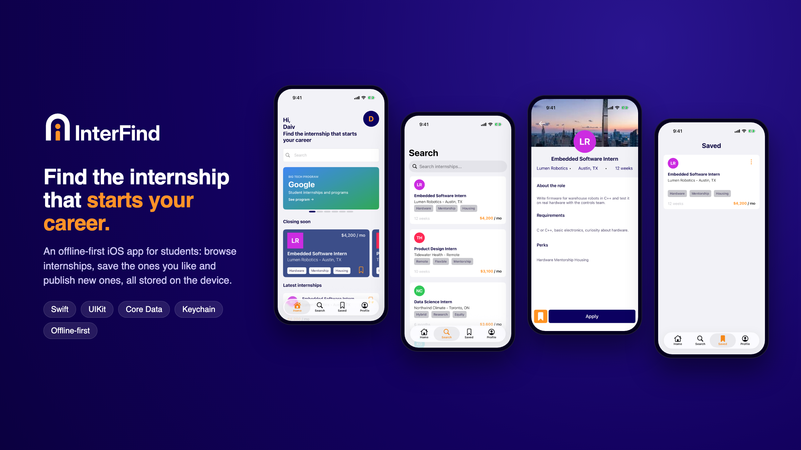
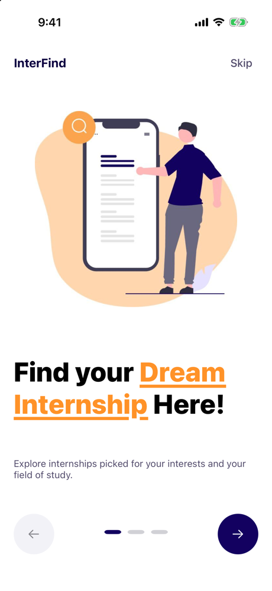
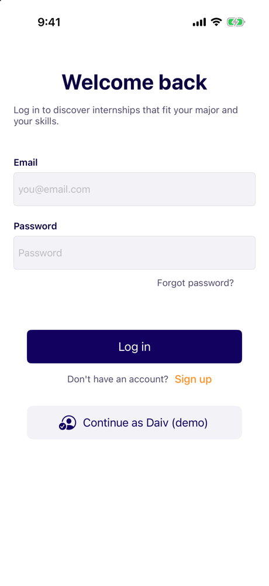
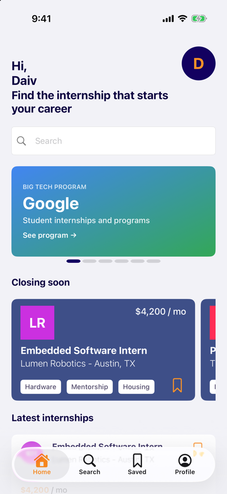
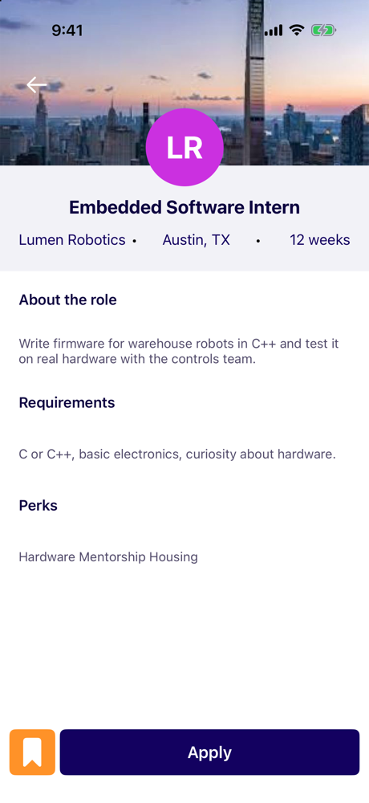
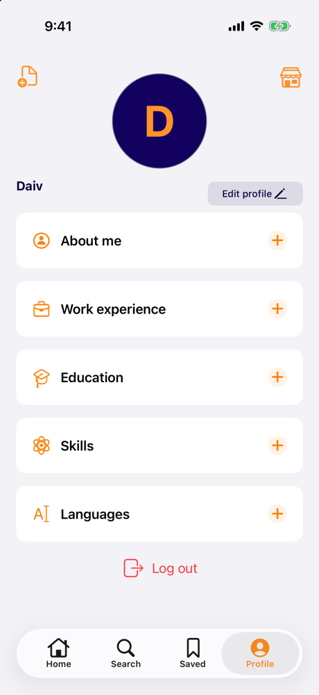

<p align="center">
  
</p>

<h1 align="center">InterFind</h1>

<p align="center">An offline-first iOS app for students looking for their first internship.</p>

<p align="center">
  
</p>

<p align="center">
  
  
  
  
  
</p>

## About

InterFind is kind of a fork of **PasaFinder**, the iOS app my team and I built and presented in 2024 as the final project of our iOS diploma course. It starts from that codebase and goes further than what we presented back then.

The original app was built to work against a real backend: a REST API for accounts and listings, plus Firebase. This version doesn't use any API. It replaces those production-oriented pieces with local implementations, so anyone can clone it, hit Run and try every feature without a server, keys or an internet connection. That makes it portfolio-friendly rather than production-ready.

What changed since the 2024 version:

- **No backend:** a local store replaces the API for internships, images and accounts
- **No Firebase:** the SDK and its configuration are gone
- **New flow:** first-launch onboarding, a one-tap demo account and log out
- **Redesigned UI:** new tabs, Search as its own tab, initials avatars, per-listing stipends
- **New brand:** name, logo, app icon and launch screen
- **English throughout:** UI, code and docs

## Features

- **Onboarding** that only shows on first launch
- **Local accounts**: sign up and log in on the device, or tap *Continue as Daiv (demo)*
- **Home** with Big Tech program banners, internships closing soon and the latest listings
- **Search** across title, company and perks
- **Saved** internships stored with Core Data
- **Admin tools** to publish and delete internships, with an image from the photo library
- **Profile** with an initials avatar, editable details and log out

## Demo account

| Name | Email | Password |
|---|---|---|
| Daiv | `daiv@interfind.app` | `interfind` |

It is also the admin account, so it can publish and delete internships.

## How it works

| Concern | Implementation |
|---|---|
| Internships | JSON file in `Documents`, seeded from `Resources/SampleData/internships.json` |
| Images | JPG files in `Documents/Images`; companies without a logo get a generated initials badge |
| Accounts | Profile in `UserDefaults`, password stored as a salted SHA-256 hash |
| Session | Token in the Keychain, expires after 30 days |
| Saved internships | Core Data |
| Navigation | `AppRouter` swaps the root between onboarding, login and the tab bar |

The sample internships use fictional companies. The Big Tech banners only link to each company's official student careers page.

## Project structure

```
InterFind/
├── InterFind.xcodeproj
├── InterFind/
│   ├── App/            AppDelegate, SceneDelegate, AppRouter
│   ├── Components/     Reusable buttons, labels, text fields and views (IF prefix)
│   ├── Controllers/    Screen logic (home, login, search, admin)
│   ├── Extensions/
│   ├── Managers/       LocalStore, Core Data, Keychain, UserDefaults
│   ├── Model/          Models and the Core Data stack (Model/CoreData)
│   ├── Resources/      Assets, launch screen, sample data
│   ├── Utils/
│   └── Views/          Onboarding, Login, SignUp, Home, Search, JobDetail, Favorite, Profile, Admin
├── InterFindUITests/
└── docs/
    ├── branding/       Logo source files, exports and concept sheet
    └── screenshots/
```

## Requirements

- Xcode 16 or later
- iOS 16.6 or later

Open `InterFind.xcodeproj`, pick a simulator and run. To run on a device, choose your own team under *Signing & Capabilities*.

## Branding

The logo is an "i" (the intern) walking through an open arch: your door into the industry. Source SVGs live in `docs/branding/logo`; the wordmark is set in [Inter](https://rsms.me/inter/) (SIL Open Font License) and converted to outlines.

| Color | Hex |
|---|---|
| Navy | `#130160` |
| Orange | `#FF9228` |

## Credits

Based on PasaFinder, originally built as a team project. The original authors are kept in the file headers and in `LICENSE`.

## License

MIT. See [LICENSE](LICENSE).
